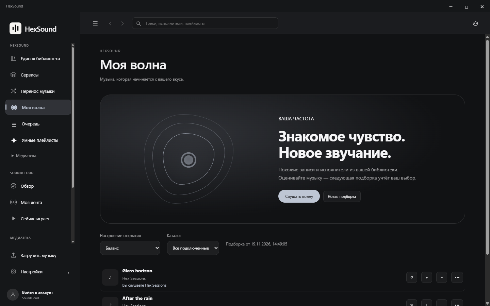
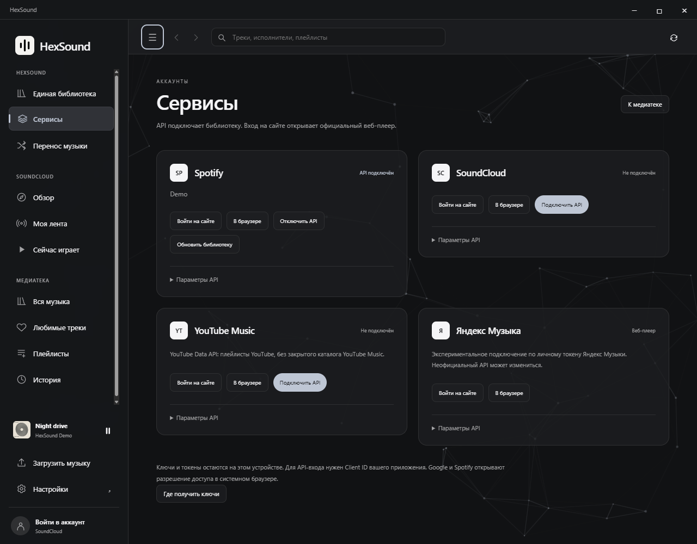
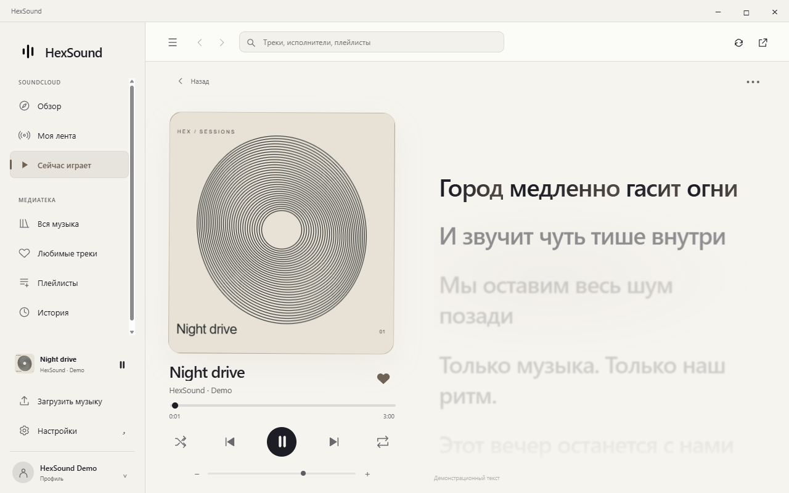

<p align="center"></p>

<p align="center"><a href="README.md">Русский</a> · <b>English</b></p>
<p align="center"><a href="https://github.com/hexokryn/HexSound/releases/latest">Download</a> · <a href="docs/services.md">Connect services</a> · <a href="https://t.me/zexokkydev">Developer's Telegram</a></p>

HexSound is a unified music library for Windows and Linux. Tracks and playlists from connected services have their own interface with search, playlist transfers and a dedicated player with lyrics. The app UI is currently in Russian.


Version 0.9.2 unifies navigation, moves connection/transfer tools into Settings, adds SoundCloud web-session import, eight background effects and a verified startup update flow. The memory improvements from 0.8.1 remain.

## Personal radio and collection tools



“My Wave” finds catalogue tracks from your library's artists and related recordings, with a reason shown for each suggestion. Choose a catalogue, adjust discovery, like tracks or exclude them. New selections require a connected catalogue API. Selection logic belongs to HexSound.

Version 0.8 also adds a persistent queue with drag and drop, an always-on-top mini-player, local music folders, tags, rule-based playlists, manual duplicate decisions and local listening statistics. Interrupted transfers can resume after verifying the destination playlist.

The [feature guide](docs/experience.md) describes these workflows in Russian.

## Download

| Platform | Build | Download |
| :--- | :--- | :--- |
| Windows x64 | Setup with a folder picker and shortcuts | [HexSound-0.9.2-setup.exe](https://github.com/hexokryn/HexSound/releases/download/v0.9.2/HexSound-0.9.2-setup.exe) |
| Windows x64 | Portable, no installation | [HexSound-0.9.2-portable.exe](https://github.com/hexokryn/HexSound/releases/download/v0.9.2/HexSound-0.9.2-portable.exe) |
| Linux x64 | AppImage | [HexSound-0.9.2-linux-x86_64.AppImage](https://github.com/hexokryn/HexSound/releases/download/v0.9.2/HexSound-0.9.2-linux-x86_64.AppImage) |
| Linux x64 | DEB package | [HexSound-0.9.2-linux-amd64.deb](https://github.com/hexokryn/HexSound/releases/download/v0.9.2/HexSound-0.9.2-linux-amd64.deb) |
| Linux x64 | tar.gz archive | [HexSound-0.9.2-linux-x64.tar.gz](https://github.com/hexokryn/HexSound/releases/download/v0.9.2/HexSound-0.9.2-linux-x64.tar.gz) |

Make the AppImage executable before launching it:

```sh
chmod +x HexSound-0.9.2-linux-x86_64.AppImage
./HexSound-0.9.2-linux-x86_64.AppImage
```

If FUSE is unavailable, the [Linux guide](docs/linux.md) describes how to extract and run the AppImage. It also covers dependencies and system secret storage.

Quit the previous version through **tray → Выйти (Quit)** before updating. Windows stores the profile in `%APPDATA%/HexSound`, including for Portable. Updates are checked at startup, with download, skip and changelog controls. Windows EXE files are unsigned.

## Your library

- The library is the default screen. Search the local collection, filter by service and playlist, or select a connected API catalogue to search there.
- Refresh imports the tracks and playlists available to the connected account. File import remains available without an API connection.
- Export a JSON backup or import JSON and CSV. These files contain lists and metadata, not downloaded audio. API secrets aren't included in exports.
- Transfers search for matching recordings first. Ambiguous results require a choice or a skip. After review, the app creates a new playlist in the target service and keeps the source playlist.
- A transfer plan is bound to its target connection. If the account changes, review a new plan. Partial writes and failures appear in the operation result.

[Import formats and example files](docs/library-import.md)

<table>
  <tr><td></td><td></td></tr>
  <tr><td align="center">Connections</td><td align="center">Review before transfer</td></tr>
</table>

## Connect services

API access and ordinary website sign-in are separate connections. API access reads libraries and writes playlists. Website sign-in opens the official player in a separate service session; it doesn't produce an API token.

| Service | Library access |
| :--- | :--- |
| Spotify | Official API, OAuth PKCE or a personal access token. Saved tracks and accessible playlists. |
| SoundCloud | Official API, OAuth or a personal access token. Likes and your own playlists. |
| YouTube Music / YouTube | YouTube Data API for your own YouTube playlists. A separate API key allows public search, not access to private data. |
| Yandex Music | An experimental Music API adapter with a personal music token. Ordinary website sign-in is separate. |

Register your own application with the provider and enter its **Client ID** in HexSound for OAuth. SoundCloud also requires a Client Secret; Google needs a Desktop app OAuth client. The [connection guide](docs/services.md) lists redirect URIs and permissions. HexSound doesn't ship shared provider client credentials.

YouTube Data API doesn't expose the entire private YouTube Music catalogue or personal Music library. An ordinary Yandex ID key doesn't grant access to Yandex Music's API. The experimental Yandex adapter uses an undocumented interface that may change at the provider's end.

Access tokens and Client Secrets use protected input fields and are handled in the main process. Stored secrets aren't returned to the UI. Persistence uses Electron `safeStorage`. On Linux without a working Secret Service/KWallet backend, secrets stay in memory for the current session rather than being written to a plaintext file.

## Player and appearance

<table>
  <tr><td></td><td></td></tr>
  <tr><td align="center">Dark mode</td><td align="center">Light mode</td></tr>
</table>

Screenshots use demo data. They are actual app screens, not evidence of access to personal service accounts.

Lyrics from [LRCLIB](https://lrclib.net) or a local LRC file follow line timestamps. The active line is readable immediately; word animations don't hide it after its start. The clock accounts for snapshot age and seeks. If a precise media clock is unavailable, the app estimates from the observed service timeline. Manual scrolling stops automatic following.

Appearance settings include 32 themes, light and dark modes, 17 animated backgrounds and custom images. Artwork motion, sidebar visibility and animations can be changed separately.

Library browsing, search, radio and transfers use HexSound's own interface. Local files and available SoundCloud API streams use a native audio engine with automatic queue advancement. SoundCloud may restrict a stream or provide a preview. Other sources use official web players, including DRM handling; automatic playback and controls depend on the website. Not every provider website screen is replaced.

## Development and checks

Install Node.js and npm, then run:

```sh
npm ci
npm start
```

```sh
npm test
npm run check:library
npm run check:experience
```

Build on the corresponding platform:

```sh
npm run dist        # Windows: Setup and Portable
npm run dist:linux  # Linux: AppImage, DEB and tar.gz
```

Automated checks use isolated data. Full OAuth, library sync and remote playlist write verification require your own credentials and application permissions. An adapter doesn't establish that every account has access. Provider quotas and restrictions still apply.

Service pages have Node.js disabled, sandbox and context isolation enabled. IPC is available to the local shell. Website sign-in doesn't extract passwords or cookies into API connections.

[API connections](docs/services.md) · [Library import](docs/library-import.md) · [Linux](docs/linux.md)

## Author

[hexokryn](https://github.com/hexokryn) · [zexokky://DEV on Telegram](https://t.me/zexokkydev)

[MIT](LICENSE). HexSound isn't affiliated with the listed music services or Apple. Service names and content belong to their respective owners.
