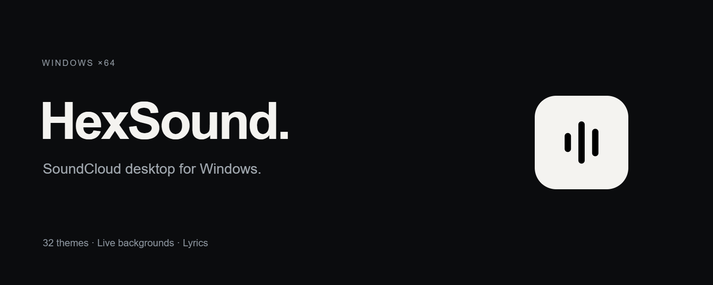
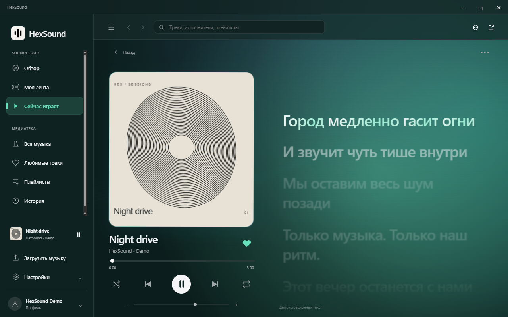
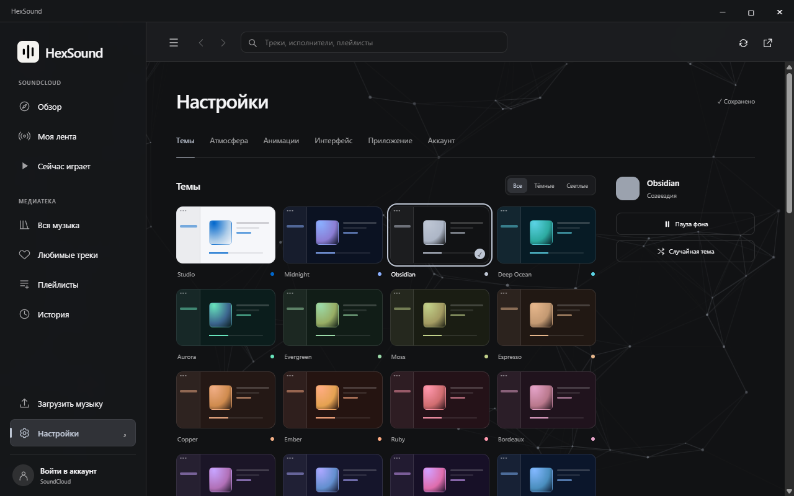
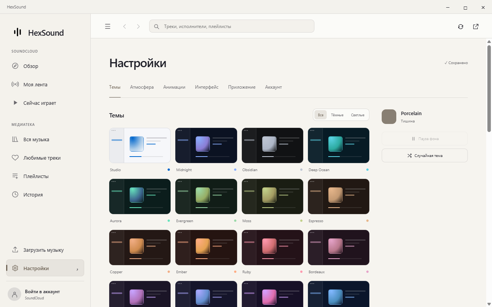
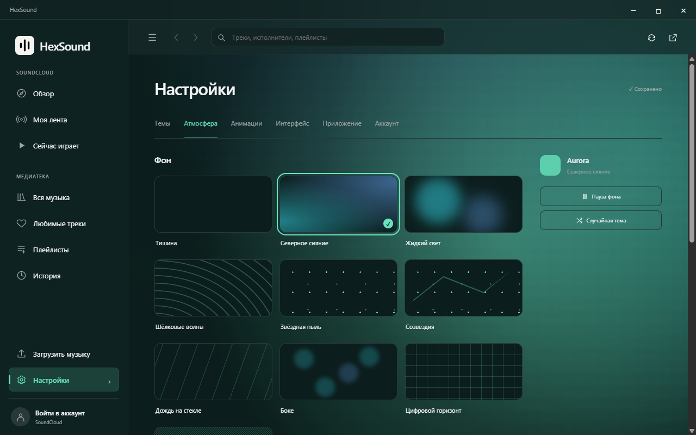

<p align="center"></p>

<p align="center"><a href="README.md">Русский</a> · <b>English</b></p>
<p align="center"><a href="https://github.com/hexokryn/HexSound/releases/latest">Download</a> · <a href="https://github.com/hexokryn/HexSound/releases/download/v0.6.0/HexSound-telegram.mp4">20-second video</a> · <a href="https://t.me/zexokkydev">Developer's Telegram</a></p>

HexSound is an unofficial SoundCloud desktop app for Windows. It has a minimal shell, a dedicated player with lyrics, and appearance settings for your own setup. The app interface is currently in Russian.



## Download

| Version | Use | Windows x64 |
| :--- | :--- | :--- |
| **Setup** | Install with a folder picker, shortcuts and Windows uninstall support | [HexSound-0.6.0-setup.exe](https://github.com/hexokryn/HexSound/releases/download/v0.6.0/HexSound-0.6.0-setup.exe) |
| **Portable** | Run without installation | [HexSound-0.6.0-portable.exe](https://github.com/hexokryn/HexSound/releases/download/v0.6.0/HexSound-0.6.0-portable.exe) |

Close the previous version using **tray → Выйти (Quit)** before opening a new one. Settings and your session stay in `%APPDATA%/HexSound`. The portable build also uses this folder; it doesn't keep the profile beside the EXE. Builds are unsigned. Automatic updates aren't implemented yet.

## Inside the app

- Sign in to SoundCloud inside the app; your profile appears at the bottom of the sidebar. Browse, search, library, likes and playlists use the SoundCloud website.
- 32 colour themes, light and dark modes, and system appearance support.
- 9 animated backgrounds plus a still mode: aurora, waves, stars, constellations, rain and more. Custom images, intensity, speed and pause controls.
- A dedicated player with artwork, controls, seeking and volume on the left, and lyrics on the right.
- Lyrics from [LRCLIB](https://lrclib.net), line timestamps, three word entrance styles and local LRC imports. Online lyrics can be disabled.
- Floating artwork, a subtle turn and pointer tilt. Open the player's **•••** menu to change these settings.
- Collapse the sidebar or hide navigation items, comments, recommendations and statistics. Zoom from 85–125%.
- A launch animation, tray playback, keyboard shortcuts and optional launch at login.

## Appearance

<table>
  <tr><td></td><td></td></tr>
  <tr><td align="center">Dark themes</td><td align="center">Light themes</td></tr>
</table>



## Light player


Player screenshots and the video use **Night drive**, a demo track with original artwork and sample lyrics. These are actual app screens with demo data. Lyrics availability for real tracks depends on LRCLIB.

## Before you start

SoundCloud must be reachable from your network. Its region, subscription and track restrictions still apply. Offline music downloads aren't implemented.

Authentication takes place on SoundCloud or provider pages. If Google or Apple blocks the embedded browser, use SoundCloud email sign-in. The local shell doesn't receive your password. LRCLIB searches include the track title, artist and duration; online searches can be switched off.

The minimum window is 360×480 logical pixels. Narrow windows use a drawer and put lyrics below the artwork. Layout checks cover 16 sizes up to 3840×2160. SoundCloud website changes may require updates to the injected styles.

## Development

Install Node.js and npm, then run:

```sh
npm ci
npm start
```

```sh
npm test
npx electron . --layout-test
npx electron . --effects-test
npm run dist
```

`npm run dist` builds NSIS Setup and Portable for Windows into `release/`. SoundCloud has its own session, separate from regular browsers. The service page has Node.js disabled, sandbox and context isolation enabled. Only the local shell can access the IPC bridge.

[Detailed development notes in Russian](docs/development.ru.md) · [Video production](docs/media-production.md)

## Author

[hexokryn](https://github.com/hexokryn) · [zexokky://DEV on Telegram](https://t.me/zexokkydev)

[MIT](LICENSE). HexSound isn't affiliated with SoundCloud or Apple. Service names and content belong to their respective owners.
