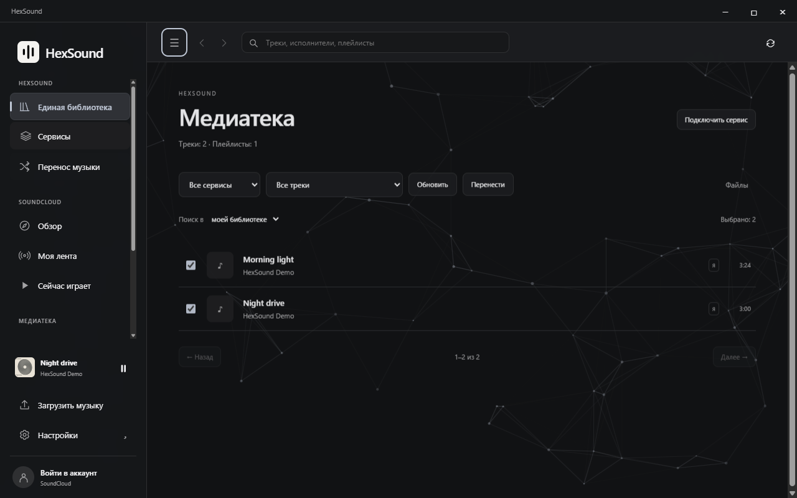
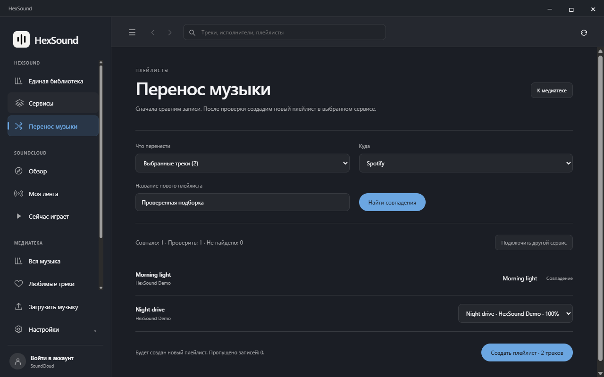
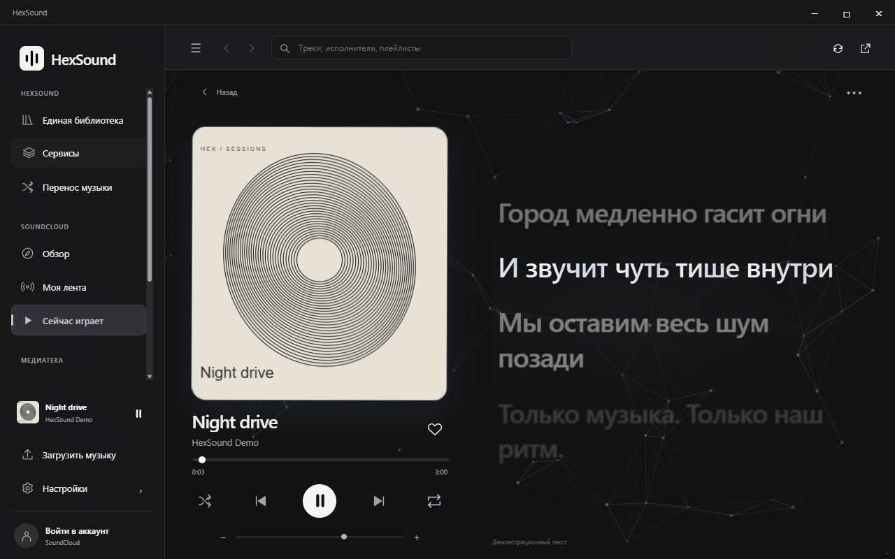

<p align="center"></p>

<p align="center"><b>Русский</b> · <a href="README.en.md">English</a></p>
<p align="center"><a href="https://github.com/hexokryn/HexSound/releases/latest">Скачать</a> · <a href="docs/services.md">Подключить сервисы</a> · <a href="https://t.me/zexokkydev">Telegram автора</a></p>

HexSound — единая музыкальная библиотека для Windows и Linux. Треки и плейлисты из подключённых сервисов собраны в собственном интерфейсе с поиском, переносом и отдельным плеером с текстом песен.



## Моя волна и новая медиатека


Волна ищет похожие записи по вашей библиотеке и объясняет выбор. Можно менять долю нового, выбирать каталог, отмечать понравившееся и исключать треки. Для новых подборок подключите API каталога; алгоритм подбора собственный.

В версии 0.8 также появились сохраняемая очередь с перетаскиванием, мини-плеер поверх окон, музыкальные папки, теги, умные плейлисты, ручное объединение записей и локальная статистика. Незавершённый перенос можно продолжить после проверки содержимого целевого плейлиста.

[Как пользоваться волной, очередью и локальной коллекцией](docs/experience.md)

## Скачать

| Платформа | Вариант | Загрузка |
| :--- | :--- | :--- |
| Windows x64 | Setup с выбором папки и ярлыками | [HexSound-0.8.0-setup.exe](https://github.com/hexokryn/HexSound/releases/download/v0.8.0/HexSound-0.8.0-setup.exe) |
| Windows x64 | Portable без установки | [HexSound-0.8.0-portable.exe](https://github.com/hexokryn/HexSound/releases/download/v0.8.0/HexSound-0.8.0-portable.exe) |
| Linux x64 | AppImage | [HexSound-0.8.0-linux-x86_64.AppImage](https://github.com/hexokryn/HexSound/releases/download/v0.8.0/HexSound-0.8.0-linux-x86_64.AppImage) |
| Linux x64 | Пакет DEB | [HexSound-0.8.0-linux-amd64.deb](https://github.com/hexokryn/HexSound/releases/download/v0.8.0/HexSound-0.8.0-linux-amd64.deb) |
| Linux x64 | Архив tar.gz | [HexSound-0.8.0-linux-x64.tar.gz](https://github.com/hexokryn/HexSound/releases/download/v0.8.0/HexSound-0.8.0-linux-x64.tar.gz) |

Для AppImage разрешите запуск файла:

```sh
chmod +x HexSound-0.8.0-linux-x86_64.AppImage
./HexSound-0.8.0-linux-x86_64.AppImage
```

Если FUSE недоступен, в [инструкции для Linux](docs/linux.md) описан запуск через извлечение AppImage. Там же указаны зависимости и настройка системного хранилища секретов.

Перед обновлением завершите предыдущую версию через **трей → Выйти**. В Windows профиль хранится в `%APPDATA%/HexSound`, в том числе у Portable. Автоматического обновления пока нет; Windows EXE не подписаны цифровой подписью.

## Своя медиатека

- Приложение открывается на экране библиотеки. Можно искать по всей локальной коллекции, фильтровать сервис и плейлист или выбрать каталог подключённого API для поиска.
- Обновление загружает доступные треки и плейлисты подключённого аккаунта. Для неподключённых сервисов остаётся импорт файла.
- Резервная копия сохраняется в JSON; импорт принимает JSON и CSV. Это списки и метаданные, а не скачивание аудиофайлов. Секреты API не включаются в экспорт.
- Перенос сначала ищет совпадения. Неоднозначные записи требуют выбора или пропуска, после проверки создаётся новый плейлист в целевом сервисе. Исходный плейлист сохраняется.
- План переноса привязан к целевому подключению. После смены аккаунта нужно заново проверить совпадения. Частичные записи и ошибки учитываются в результате операции.

[Форматы импорта и примеры файлов](docs/library-import.md)

<table>
  <tr><td></td><td></td></tr>
  <tr><td align="center">Подключения</td><td align="center">Проверка перед переносом</td></tr>
</table>

## Подключение сервисов

API-вход и обычный вход на сайте разделены. API даёт доступ к библиотеке и записи плейлистов. Обычный вход открывает официальный веб-плеер в отдельной сессии сервиса и не превращается в API-токен.

| Сервис | Доступ к библиотеке |
| :--- | :--- |
| Spotify | Официальный API, OAuth PKCE или собственный access token. Сохранённые треки и доступные плейлисты. |
| SoundCloud | Официальный API, OAuth или собственный access token. Лайки и собственные плейлисты. |
| YouTube Music / YouTube | YouTube Data API: собственные плейлисты YouTube. Отдельный API key разрешает публичный поиск, но не доступ к личным данным. |
| Яндекс Музыка | Экспериментальный адаптер Music API с личным музыкальным токеном. Обычный вход на сайте доступен отдельно. |

Для OAuth зарегистрируйте своё приложение у провайдера и укажите **Client ID** в HexSound. SoundCloud также требует Client Secret; для Google нужен OAuth client типа Desktop app. Redirect URI и необходимые разрешения описаны в [инструкции подключения](docs/services.md). Общих встроенных клиентских ключей в приложении нет.

YouTube Data API не открывает весь закрытый каталог и личную медиатеку YouTube Music. Обычный ключ Yandex ID сам по себе не даёт доступ к API Яндекс Музыки. Её экспериментальный адаптер использует недокументированный интерфейс, который может измениться на стороне сервиса.

Access Token и Client Secret вводятся в защищённые поля и обрабатываются главным процессом. Сохранённые секреты не возвращаются в интерфейс; для хранения используется Electron `safeStorage`. На Linux без рабочего Secret Service/KWallet секреты остаются только на текущий запуск, без записи в открытый текстовый файл.

## Плеер и оформление

<table>
  <tr><td></td><td></td></tr>
  <tr><td align="center">Тёмный режим</td><td align="center">Светлый режим</td></tr>
</table>

На скриншотах используются демонстрационные данные. Это реальные экраны приложения, а не подтверждение доступа к личным аккаунтам сервисов.

Текст из [LRCLIB](https://lrclib.net) или собственного LRC-файла следует таймкодам строк. Активная строка читается сразу: анимация слов не скрывает её после начала. Часы учитывают время получения снимка плеера и перемотку; при недоступных точных часах используется оценка по наблюдаемому таймлайну сервиса. Ручная прокрутка останавливает слежение за строкой.

В оформлении доступны 32 темы, светлый и тёмный режим, девять анимированных фонов и свои изображения. Можно настроить движение обложки, скрыть боковую панель и отключить анимации.

Медиатека, поиск, волна и перенос работают в интерфейсе HexSound. Локальные файлы и доступные потоки SoundCloud API воспроизводятся собственным аудиодвижком с автоматическим переходом в очереди. SoundCloud может ограничить доступ или предоставить только превью. Для остальных сервисов используются официальные веб-плееры, включая обработку DRM. Автоматический запуск и команды в них зависят от сайта. Полная замена всех экранов сервисов не реализована.

## Разработка и проверка

Нужны Node.js и npm. Интерфейс приложения сейчас на русском; этот README также доступен на английском.

```sh
npm ci
npm start
```

```sh
npm test
npm run check:library
npm run check:experience
```

Сборка на соответствующей платформе:

```sh
npm run dist        # Windows: Setup и Portable
npm run dist:linux  # Linux: AppImage, DEB и tar.gz
```

Автоматические проверки используют изолированные данные. Полная проверка OAuth, синхронизации и записи в реальные аккаунты требует собственных учётных данных и разрешений приложений; наличие адаптера не подтверждает доступ к каждому аккаунту. API-квоты и ограничения провайдеров сохраняются.

Страницы сервисов работают без Node.js, с sandbox и context isolation. IPC доступен локальной оболочке. Авторизация на сайтах не извлекает пароли или cookies в API-подключение.

[Подключение API](docs/services.md) · [Импорт библиотеки](docs/library-import.md) · [Linux](docs/linux.md)

## Автор

[hexokryn](https://github.com/hexokryn) · [zexokky://DEV в Telegram](https://t.me/zexokkydev)

[MIT](LICENSE). HexSound не связан с перечисленными музыкальными сервисами или Apple. Названия и материалы сервисов принадлежат их владельцам.
