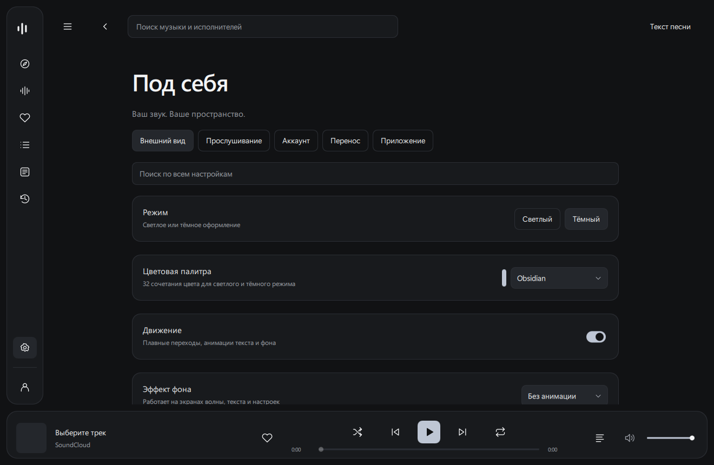
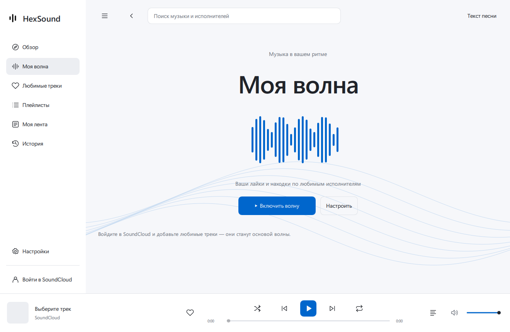

# HexSound

[Русский](README.md) · [English](README.en.md) · [Скачать](https://github.com/hexokryn/HexSound/releases/latest) · [Telegram автора](https://t.me/zexokkydev)

SoundCloud для Windows с собственным плеером, темами и текстом песни. Приложение перенесено на C++20 и Qt Quick/QML. Каталог и воспроизведение используют официальный SoundCloud в Qt WebEngine; Node.js и Electron новой версии не нужны. Linux собирается отдельной задачей CI и пока не входит в новый релиз.



- Нижняя панель воспроизведения и отдельный экран с текстом песни
- 32 темы, фоны, настройки движения и скрываемая боковая панель
- «Моя волна» по лайкам SoundCloud без API-ключей
- Импорт CSV, TSV и JSON в новый плейлист SoundCloud с проверкой совпадений
- Кнопка обновления сверху: загрузка ZIP из GitHub Releases, проверка и замена файлов с резервной копией
- Discord Rich Presence с собственным публичным Application ID

Для прослушивания нужен обычный вход SoundCloud. Импорт файла сам по себе не изменяет аккаунт: запись нового плейлиста требует подключения SoundCloud API и подтверждения совпадений. Доступность треков зависит от SoundCloud и региона. Текст песни ищется в LRCLIB или загружается из LRC.

## Скачать

[Windows Setup 0.13.0](https://github.com/hexokryn/HexSound/releases/download/v0.13.0/HexSound-0.13.0-setup.exe) · [Portable ZIP](https://github.com/hexokryn/HexSound/releases/download/v0.13.0/HexSound-0.13.0-native-portable.zip) · [SHA-256](https://github.com/hexokryn/HexSound/releases/download/v0.13.0/HexSound-0.13.0-SHA256SUMS.txt)

Setup устанавливает приложение для текущего пользователя. Portable ZIP нужно распаковать целиком и запустить `HexSound.exe`; файл `portable` включает хранение данных рядом с приложением. Дальнейшие обновления C++-версии выполняются внутри приложения без запуска Setup. Установщик не подписан цифровой подписью.

Для перехода с Electron установите 0.13.0 через Setup. У неё отдельный профиль Qt WebEngine: войдите в SoundCloud заново. Данные установленной версии не удаляются, браузерные токены и cookies из неё не извлекаются. Прежние Linux-пакеты остаются в [архивном релизе 0.11.0](https://github.com/hexokryn/HexSound/releases/tag/v0.11.0).

## Разработка

C++20, CMake 3.21+, Qt 6.8 или новее с модулями Quick, Quick Controls, WebEngine, WebChannel, Positioning и ShaderTools. Релизный SDK: Qt 6.12.1 и Qt WebEngine 6.140.0. Скрипт ниже загружает их из официальных репозиториев Qt с проверкой контрольных сумм. Для него нужен Python 3.12+; приложению Python не нужен.

```powershell
python scripts/install-qt.py
./scripts/build-native.ps1 -Test -Deploy
./release/HexSound-native/HexSound.exe
```

Для setup и portable ZIP после сборки: `./scripts/package-native.ps1` (нужен NSIS).

Для собственного установленного Qt укажите `-QtRoot C:/Qt/6.12.1/msvc2022_64`. Не переносите один EXE отдельно от DLL, QML-модулей и `resources`. Автоматические проверки используют отдельный профиль и локальную аудиозапись; они не проверяют вход в частный аккаунт и реальную запись через SoundCloud API.



[Структура и проверки](docs/development.ru.md) · [Волна и воспроизведение](docs/experience.md) · [Импорт файлов](docs/library-import.md) · [SoundCloud API](docs/services.md)

Неофициальный клиент, не связан с SoundCloud. [MIT](LICENSE).
