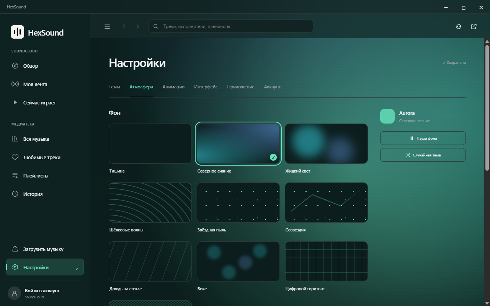

<p align="center"></p>

<p align="center"><b>Русский</b> · <a href="README.en.md">English</a></p>
<p align="center"><a href="https://github.com/hexokryn/HexSound/releases/latest">Скачать</a> · <a href="https://github.com/hexokryn/HexSound/releases/download/v0.6.0/HexSound-telegram.mp4">Видео, 20 секунд</a> · <a href="https://t.me/zexokkydev">Telegram автора</a></p>

HexSound — неофициальное приложение SoundCloud для Windows. Минималистичная оболочка, отдельный плеер с текстом песен и оформление, которое можно настроить под себя.


## Скачать

| Вариант | Для чего | Windows x64 |
| :--- | :--- | :--- |
| **Setup** | Установка с выбором папки, ярлыками и удалением через Windows | [HexSound-0.6.0-setup.exe](https://github.com/hexokryn/HexSound/releases/download/v0.6.0/HexSound-0.6.0-setup.exe) |
| **Portable** | Запуск без установки | [HexSound-0.6.0-portable.exe](https://github.com/hexokryn/HexSound/releases/download/v0.6.0/HexSound-0.6.0-portable.exe) |

Закройте предыдущую версию через **трей → Выйти**, затем запустите новую. Настройки и вход сохраняются в `%APPDATA%/HexSound`. Portable тоже хранит профиль в этой папке, а не рядом с EXE. Сборки не подписаны цифровой подписью; автоматического обновления пока нет.

## Что внутри

- Вход в SoundCloud прямо в приложении, профиль внизу боковой панели. Каталог, поиск, библиотека, лайки и плейлисты работают через страницу SoundCloud.
- 32 цветовые темы, светлый и тёмный режим, переключение вместе с системой.
- 9 анимированных фонов и режим без эффекта: сияние, волны, звёзды, созвездия, дождь и другие. Свои изображения, интенсивность, скорость и пауза.
- Отдельный плеер: обложка, управление, перемотка и громкость слева; текст песни справа.
- Тексты из [LRCLIB](https://lrclib.net), синхронизация по строкам, три анимации появления слов и импорт собственных LRC-файлов. Поиск текста можно отключить.
- Парение или лёгкий поворот обложки, наклон за курсором. Настройки движений находятся в меню плеера **•••**.
- Скрытие боковой панели, разделов навигации, комментариев, рекомендаций и статистики. Масштаб 85–125%.
- Анимация запуска, сворачивание в трей, горячие клавиши и автозапуск по желанию.

## Оформление

<table>
  <tr><td></td><td></td></tr>
  <tr><td align="center">Тёмные темы</td><td align="center">Светлые темы</td></tr>
</table>



## Светлый плеер


На скриншотах плеера и в видео используется демонстрационный трек **Night drive** с собственной обложкой и текстом. Это реальные экраны приложения с демонстрационными данными; наличие текста у конкретных песен зависит от LRCLIB.

## Перед запуском

Нужен доступ к SoundCloud. Ограничения сервиса по региону, подписке и правам на треки сохраняются. Скачивание музыки для офлайн-прослушивания не реализовано.

Вход проходит на страницах SoundCloud и провайдеров. Если Google или Apple не разрешает встроенный браузер, используйте вход SoundCloud по почте. Пароль не передаётся локальной оболочке. Запрос текста в LRCLIB содержит название, исполнителя и длительность; этот поиск можно выключить.

Минимальное окно — 360×480 логических пикселей. На узком экране панель выдвигается, а текст располагается под обложкой. Проверены 16 размеров до 3840×2160. Оформление страниц SoundCloud может потребовать обновления при изменениях сайта.

## Разработка

Нужны Node.js и npm.

```sh
npm ci
npm start
```

```sh
npm test
npx electron . --layout-test
npx electron . --effects-test
npm run dist
```

`npm run dist` создаёт установщик NSIS и Portable для Windows в `release/`. Сессия SoundCloud отделена от профилей обычных браузеров. У страницы сервиса отключён Node.js, включены sandbox и context isolation; IPC доступен только локальной оболочке.

[Подробности разработки и проверок](docs/development.ru.md) · [Создание видео](docs/media-production.md)

## Автор

[hexokryn](https://github.com/hexokryn) · [zexokky://DEV в Telegram](https://t.me/zexokkydev)

[MIT](LICENSE). HexSound не связан с SoundCloud или Apple. Названия и материалы сервисов принадлежат их владельцам.
