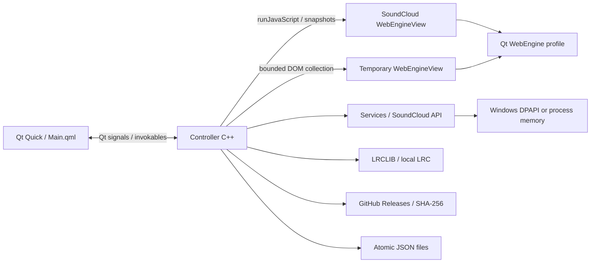

# Разработка HexSound на C++

Состояние на 28 ноября 2026: C++-версия 0.13.0 [опубликована для Windows](https://github.com/hexokryn/HexSound/releases/tag/v0.13.0). Приложение остаётся клиентом SoundCloud. Версии до 0.11.0 использовали Electron; они сохраняются в истории Git и Releases.

## Проверка выпуска 0.13.0

[Windows job 141019023620](https://github.com/hexokryn/HexSound/actions/runs/46158076143/job/141019023620) прошёл на Windows Server 2022 с Qt 6.12.1 и Qt WebEngine 6.140.0: native_tests (9), controller_tests (14), rpc_tests (3), smoke сборки, smoke развернутой папки без Qt в PATH, NSIS/ZIP и тесты обновления с заменой, перезапуском и откатом заблокированного файла. Числа QtTest включают init/cleanup. Проверены локальный WAV, громкость, pause, сохранение страницы при SPA-навигации и QML. Установщик не запускался.

Релиз создан из 51a808c89cc5bcaffa16ddabd01d58ebe3921447. В main дополнительно исправлен путь распаковки ICU для Linux. Setup и ZIP содержат Windows x64; опубликованные файлы имеют digest SHA-256 в GitHub API и отдельный SHA256SUMS.txt. Архивы профилей и материалы Telegram отсутствуют.

На локальной машине новый WebEngine при запуске из среды Codex завершал renderer с кодом 18, поэтому локальный smoke не пройден; точная причина не установлена. Проверка на GitHub runner прошла с включённым sandbox. Smoke теперь явно проверяет наличие всех пяти результатов JavaScript и завершение renderer: отсутствие callback считается ошибкой. Это устраняет прежнюю возможность получить успешный smoke без проверки звука.

Linux: сборка и три набора unit на Qt 6.12.1 проходят, GUI-smoke в Ubuntu 24.04 остановился при загрузке xcb-плагина. Следующий шаг: QT_DEBUG_PLUGINS=1 и ldd для libqxcb.so, затем установка точных недостающих системных библиотек и повторный smoke. Linux не считать готовым и не отключать sandbox ради теста.

## Архитектура



Оболочка и сервисная логика — C++ и QML. Звук воспроизводит одна официальная страница SoundCloud, поэтому нижняя панель, полноэкранный плеер и каталог управляют одним состоянием. Отдельного локального аудиодвижка нет. Удалённая страница не получает QWebChannel или объект Backend. Три JavaScript-ресурса читают публичный DOM, вызывают кнопки сайта и наблюдают mediaSession.

## Файлы

| Путь | Назначение |
| --- | --- |
| CMakeLists.txt | C++20, ресурсы QML, QtTest, установка и CPack |
| native/main.cpp | QApplication, отдельный профиль WebEngine, регистрация Backend, запуск QML, режим smoke |
| native/Controller.h и .cpp | Состояние интерфейса, настройки, команды плеера, монотонные часы, тексты, волна, импорт, GitHub-обновления |
| native/Services.h и .cpp | OAuth PKCE с localhost callback, проверка токена через /me, DPAPI, refresh, поиск совпадений, создание и продолжение плейлиста |
| native/MusicData.h и .cpp | CSV/TSV/JSON, длительности, LRC и offset, сравнение треков, допустимые URL, QSaveFile |
| native/SmokeHarness.h | Локальная проверка QML, PCM WAV, скриншоты и JSON-отчёт; отсутствует в удалённой странице |
| native/qml/Main.qml | Навигация, WebEngineView, волна, текст, настройки, нижняя панель, интро и окно обновления |
| native/qml/HSButton.qml | Кнопки с векторными иконками и состояниями наведения/фокуса |
| native/qml/HSIcon.qml | SVG-пути общей системы иконок, цвет от темы |
| native/qml/HSField.qml | Поля ввода и поиска |
| native/qml/HSSlider.qml | Громкость и позиция трека |
| native/qml/HSSwitch.qml | Переключатели настроек |
| native/qml/Setting.qml | Строка настройки с пояснением и контролами |
| native/assets/palettes.json | 32 исходные палитры: режим, фон, акцент |
| native/assets/remote-player.js | snapshot, control и profileURL для DOM официального сайта |
| native/assets/web-player.js | Наблюдение mediaSession и точного времени воспроизведения |
| native/assets/soundcloud.css | Тема официального каталога, диалоги, адаптивные плитки и исправление кнопок на обложках |
| native/assets/collector.js | Список треков и признак страницы входа; без чтения cookies/API-токенов |
| native/assets/mark.svg и mark-light.svg | Сохранённый минимальный знак из трёх полос |
| native/assets/icon.ico и icon.png | Иконки приложения и упаковки |
| native/windows.rc.in | Встраиваемая Windows-иконка |
| native/hexsound.desktop | Linux desktop entry |
| native/tests/tst_music.cpp | Форматы, таймкоды, сопоставление, URL и атомарное хранение |
| native/tests/tst_controller.cpp | Коалесцирование громкости, защита от старых снимков, часы, отмена волны, границы API/настроек и неизвестный перенос |
| scripts/build-native.ps1 | Поиск MSVC и Qt, сборка, проверки, windeployqt и portable-папка |
| native/licenses | Тексты лицензий Qt LGPL/GPL |
| .github/workflows/release.yml | Сборки Windows/Linux и проверки без перезаписи опубликованных релизов |

Исторические release-v*.md относятся к тем версиям, которые названы в файле. PROJECT_HANDOFF.md описывает состояние до C++-переноса и не является актуальным описанием новой архитектуры.

## Настройки и данные

По умолчанию используется QStandardPaths::AppDataLocation с именем приложения HexSoundNative. Файл portable рядом с EXE включает каталог data рядом с программой. Для отдельного профиля есть аргумент --data-dir PATH. Профиль WebEngine хранится в web, кэш ограничен 128 МБ и хранится в cache. Старые данные Electron остаются на месте.

- preferences.json: тема, режим, движение, фон, масштаб каталога, видимость деталей, громкость и параметры волны.
- wave-<SHA256 идентификатора аккаунта>.json: кэш лайков для конкретного веб-аккаунта.
- feedback.json: оценки волны, исключения и предпочтения.
- imports.json: отдельный список файла для переноса.
- transfer-journal.json: целевой API-аккаунт, подтверждённые треки, стадия операции и известный плейлист.
- api.enc: Windows DPAPI; на Linux файл секретов не создаётся.
- lyrics/<SHA256 title|artist>.json: локальный LRC в разобранном виде.
- updates: скачанный файл и временный .part.

Часы основаны на реально наблюдаемом времени аудио, mediaSession либо шкалы сайта; при неизвестном времени они не идут. Ползунок громкости отправляет первый запрос сразу, объединяет следующие изменения и не принимает старый снимок во время команды. Lyrics обновляются через отдельный короткий UI-таймер и generation guard сетевого ответа.

Волна получает лайки через временную страницу с тем же профилем, затем ищет треки по исполнителям и настроению. Это локальная эвристика, а не алгоритм Яндекс Музыки. Оценки влияют на подбор семян, дизлайки исключают записи. Есть режимы баланса, знакомой музыки и открытий. Результаты отменённой подборки игнорируются, очередь ограничена, отработанная страница уничтожается.

## Сборка Windows

Установите MSVC 2022 Build Tools с C++, Windows SDK, CMake и Qt с модулями WebEngine, WebChannel, Positioning, ShaderTools. Qt должен соответствовать MSVC x64.

```powershell
python scripts/install-qt.py
./scripts/build-native.ps1 -Test -Deploy
```

Или укажите уже установленный SDK:

```powershell
./scripts/build-native.ps1 -QtRoot C:/Qt/6.12.1/msvc2022_64 -Test -Deploy
./release/HexSound-native/HexSound.exe
```

Первоначальные локальные проверки выполнены на .tools/Qt/6.8.3/msvc2022_64. Код совместим с Qt 6.8+. Релизный SDK: Qt 6.12.1 и Qt WebEngine 6.140.0. Начиная с Qt 6.12, WebEngine поставляется отдельно в Extensions; aqt 3.3.0 не учитывал новый путь metadata. scripts/install-qt.py загружает нужные модули из официальных репозиториев с проверкой сумм архивов, а CI запрещает публикацию до успешных тестов на этом SDK. [Описание раздельных выпусков Qt WebEngine](https://www.qt.io/blog/new-release-cadence-for-qt-webengine-and-qt-pdf).

windeployqt переносит Qt, QML, WebEngineProcess, resources и MSVC runtime. Один EXE без этих файлов работать не будет. Для Windows установите NSIS и выполните ./scripts/package-native.ps1; получатся Setup, portable ZIP и файл SHA256SUMS. Setup не запускается в тестах. ./scripts/test-update.ps1 проверяет ZIP, подменённый хеш, обход пути, замену файлов и откат на изолированных фикстурах.

В .github/workflows/release.yml Windows и Linux разделены. Windows публикует новый релиз только для main с префиксом Release в сообщении коммита или ручным publish. Публикация идёт после unit/smoke, smoke папки без Qt в PATH, упаковки и тестов помощника. Существующий тег не перезаписывается. Setup нужен для первой установки; обновления C++-версии используют native-portable.zip и HexSoundUpdate.exe. Linux-пакеты остаются CI-артефактами до отдельной проверки целевой системы.

Windows-скрипт использует MSBuild (Visual Studio 17 2022), выходные EXE находятся в .tools/build-native-vs/Release. В локальной Ninja/MSVC-сборке обнаружено неверное отслеживание заголовков с русскими диагностическими сообщениями: не использовать её старый кэш, он давал несовместимые размеры классов и сбой завершения. Чистая MSBuild-сборка устраняет смешивание объектов.

## Проверки

1. native_tests и controller_tests, либо ctest --test-dir .tools/build-native-vs -C Release --output-on-failure при Qt bin в PATH.
2. HexSound.exe --smoke artifacts/native-smoke. Используется отдельный профиль, настоящий восьмисекундный PCM WAV и локальная HTML-страница. Проверяются play/pause, громкость, метаданные, работа со скрытым каталогом, SPA-навигация, темы, эффекты и QML-предупреждения.
3. Повторить --smoke на release/HexSound-native/HexSound.exe с очищенным от Qt PATH.
4. Проверить визуально PNG и report.json. Скриншоты не заменяют проверку реального аккаунта.
5. Отдельно проверить обычный вход, лайки, реальный MP3/AAC-поток, конец трека, переключение волны, API OAuth и запись в тестовый аккаунт. Эти сценарии не объявлять проверенными по WAV.
6. Linux: чистая сборка и smoke под Xvfb, затем запуск пакета на целевой системе.

Смешанный Ninja-кэш давал сбой завершения; чистый MSBuild его устранил. Отдельно воспроизведён D3D/Skia context loss при изменении размера WebEngine на Windows с Qt 6.8.3. Для этой комбинации native/main.cpp по умолчанию добавляет --disable-gpu только Chromium: нативная Qt Quick-оболочка сохраняет GPU-рендеринг. Другие SDK/платформы не переопределяются. Для диагностического сравнения есть HEXSOUND_WEBENGINE_ACCELERATION=on; не включать его в обычный запуск на проблемном хосте. Sandbox не отключался. После обновления SDK повторить resize и проверить, нужен ли этот временный обход.

## Что ещё проверять перед выпуском

Реальный вход и запись API требуют доступа владельца аккаунта. Linux/DEB не запускались локально. NSIS setup скомпилирован, его установка не запускалась. Ключи API не поставляются. Новый updater не устанавливался из теста; реальная установка должна оставаться явным действием пользователя. Не обещать экономию памяти в процентах без замеров дерева процессов на одном и том же сценарии.

## Продолжение 27 ноября 2026

Исправлена проверка API-подключения: connected доступен после /me, busy снимается после проверки, неудачная замена не восстанавливает прежний токен с диска. Числовой id используется при пустом urn. Локальный FakeApi проверяет эти сценарии, отказ записи неполного плейлиста и сохранение существующих треков при продолжении. Это проверка протокола на фикстурах, а не запись в частный SoundCloud.

Загрузчик не меняет метаданные во время загрузки, отклоняет некорректный ответ о версии. При выходе очищается веб-хранилище текущего сайта, затем cookies профиля и выполняется полная перезагрузка. Значения cookies и браузерные токены не читаются.

Упаковка Windows: `./scripts/package-native.ps1 -NsisRoot C:/NSIS` после сборки с `-Test -Deploy`. Нужен makensis в PATH либо .tools/nsis/Bin. Создаются setup, portable ZIP и SHA256SUMS. Сценарий отказывается упаковывать профиль. Установщик работает для текущего пользователя в HexSoundNative и не заменяет установленную Electron-версию. Деинсталляция удаляет только перечисленные при сборке файлы; неизвестные файлы и данные сохраняются. Установщик в тестах не запускается.

Отмена поиска совпадений освобождает захваченный список: разорван цикл владения callback/step. Регрессионная проверка следит за уничтожением маркера входных данных. Для portable и setup библиотека MSVC CRT копируется рядом с EXE; проверка модулей процесса подтвердила загрузку VCRUNTIME140.dll из release/HexSound-native. Финальный smoke развёрнутой папки выполняется без Qt в PATH. NSIS setup компилируется, но не запускается и не устанавливается в тестах. Linux проверить здесь нельзя: WSL не установлен.

## 28 ноября 2026 — версия 0.13

Оболочка: компактная скрываемая навигация, плавающий плеер, новый экран настроек с карточками и категориями. Atmosphere.qml оставляет два эффекта: световое поле и волны курсора; HoverHandler управляет положением, TapHandler — импульсом. Loader уничтожается при сворачивании. Старые значения effect переводятся в field.

DiscordPresence.cpp реализует локальный IPC Discord: handshake, READY, SET_ACTIVITY с type 2, heartbeat и переподключение. Без публичного Discord Application ID подключение не выполняется. Пользователь сообщил, что ID у него нет; поле оставлено пустым. Реальный статус не объявлять работающим до регистрации приложения. Bot token и пароль не нужны. rpc_tests проверяет протокол на локальном QLocalServer, а не на аккаунте Discord.

Обновления Windows используют native-portable.zip вместо setup.exe. Controller проверяет digest и копирует HexSoundUpdate.exe с QtCore/CRT во временную папку; помощник повторно проверяет архив, проверяет пути и ограничения ZIP на C++ (ZipCheck.h), распаковывает штатным Windows tar, ждёт процесс, сохраняет резервные файлы и выполняет атомарную запись. При ошибке записи откатывает уже записанные файлы. Данные data/web/cache и маркер portable не переносятся из архива. Не удаляются неизвестные файлы пользователя. Резервная копия сохраняется при неудаче; успешный staging освобождается. Приложение устанавливается первоначально через Setup или распаковывается из portable, но обновление не запускает Setup. Автозамена Linux пока не реализована.

Проверка помощника: scripts/test-update.ps1. Режим --verify-only распаковывает и проверяет архив в отдельной временной папке, не заменяет целевые файлы и не запускает программу. Проверяются правильный архив, неверный SHA-256 и path traversal. Полная замена установленной рабочей копии не выполняется автотестом.

Распаковка не использует PowerShell-скрипты и не меняет ExecutionPolicy. ZipCheck.h проверяет центральные и локальные заголовки, пути, типы файлов, размеры, число записей и дополнительные поля до передачи tar. Проверка указателя в smoke посылает MouseMove в собственное QQuickWindow и проверяет HoverHandler.

Финальная проверка обновления также заменяет отдельную программу update_probe в .tools/update-test-*/target и проверяет её фактический перезапуск и сохранность data/keep.txt. Рабочая программа пользователя не заменяется. Проверки RPC проходят на эмуляторе IPC. Новый экран настроек использует компактный выбор палитры вместо стены цветных карточек.

## Доводка восстановления обновлений

Помощник теперь проверяет результат каждого действия отката и не запускает смешанную версию при неполном восстановлении. Диагностический result.json рядом с job.json содержит стадии replacing, rolled-back, recovery-required или complete; резервная копия сохраняется при ошибке. Проверка блокирует последний файл через Windows FileShare.Read и подтверждает восстановление исходного EXE, удаление новых файлов, неизменность заблокированного файла и data/keep.txt. UpdateProbe записывает фактические аргументы перезапуска; тест проверяет сохранение --data-dir. Архиватор запускается без консольного окна. Таймаут закрытия родительского процесса не создаёт второй экземпляр приложения. Эти сценарии выполняются только внутри .tools/update-test-*, рабочая установленная копия не меняется.
